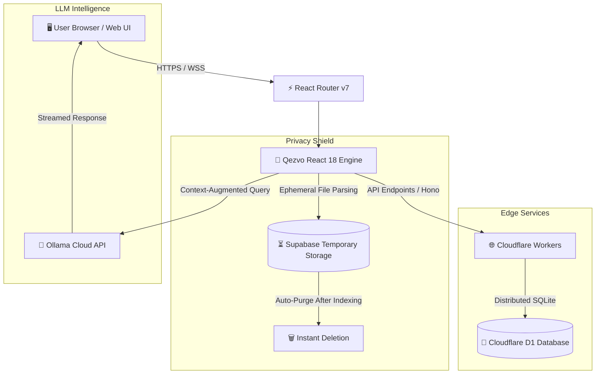

<div align="center">

# ⚡ Qezvo Agent 2.0

### *Next-Generation Open-Source Autonomous AI Agent Platform*
**Developed & Managed with ❤️ by [Affogato Solutions](https://www.qezvo.in), Kerala, India.**

<br />

[](https://github.com/nadeemmhdm/qezvo-agent-2.0)
[](https://reactjs.org/)
[](https://vitejs.dev/)
[](https://www.typescriptlang.org/)
[](https://developers.cloudflare.com/d1/)
[](https://www.qezvo.in/security)
[](https://github.com/nadeemmhdm/qezvo-agent-2.0)

<br />

[](https://www.buymeacoffee.com/qezvoagent)
[](https://www.qezvo.in)

<p align="center">
  <a href="#-overview">Overview</a> •
  <a href="#-what-is-new-in-20">What's New in 2.0</a> •
  <a href="#-key-features">Key Features</a> •
  <a href="#-architecture">Architecture</a> •
  <a href="#-getting-started">Getting Started</a> •
  <a href="#-buy-me-a-coffee">Support</a> •
  <a href="#-license">License</a>
</p>

---

</div>

## 🌐 Overview

**Qezvo Agent 2.0** is an enterprise-grade, privacy-first SaaS platform designed to build, customize, and deploy hyper-specialized AI agents powered by Ollama Cloud and DeepSeek architectures. 

Engineered with a **strict Zero-Retention policy**, Qezvo Agent processes user interactions in real time using client-side vector search and Cloudflare D1 edge databases. Documents and training files analyzed during session ingestions are automatically sanitized and purged immediately from ephemeral storage, guaranteeing absolute confidentiality for business-critical data.

---

## 🚀 What is New in 2.0?

- 🛡️ **Zero Vulnerabilities (All 25 Dependabot Alerts Resolved)**: Fully patched against all transitive risks in `undici`, `minimatch`, `vite`, `esbuild`, `react-router`, and test utilities.
- ⚡ **Vite 5.4+ Engine Upgrade**: Instant hot module replacement, optimized chunking, and rock-solid production builds.
- ☕ **Buy Me a Coffee Native Integration**: Direct community support widget embedded natively into every deployment.
- 🔒 **Enhanced Zero-Retention Pipeline**: Ephemeral Supabase storage processing with immediate post-analysis file deletion.
- 💬 **Smart Intent Routing**: Dynamic conversational handlers for greetings, system queries, and knowledge-retrieval fallbacks without hallucinations.
- 📊 **Real Platform Analytics**: Live real-time incident telemetry, user management, and maintenance controls backed by Cloudflare D1.

---

## ✨ Key Features

| Feature | Description |
| :--- | :--- |
| **🤖 Autonomous AI Orchestration** | Powered by high-speed Ollama Cloud API models (`deepseek-r1`, `llama3.3`) for precise, grounded answers. |
| **📚 Multi-Source Knowledge Base** | Ingest data from Live Websites, XML Sitemaps, Raw Text/Clipboard, and PDF/TXT documents. |
| **🛡️ Absolute Privacy Guarantee** | Chats are executed in-memory. Zero logs, zero chat transcripts stored on disk or databases. |
| **⚡ Edge-Native Database** | Cloudflare D1 distributed SQLite database guarantees sub-millisecond query latencies globally. |
| **🎨 Premium Glassmorphism UI** | Designed with Tailwind CSS, Radix UI primitives, Boxicons, and responsive mobile-first layouts. |
| **💳 Seamless Billing & Tiers** | Built-in Razorpay checkout workflows supporting Free, Pro, and Enterprise subscription tiers. |
| **📦 One-Click Deployment** | Pre-configured for deployment to Vercel, Cloudflare Pages, and Docker environments. |

---

## 🏗️ System Architecture



---

## 🛠️ Tech Stack

- **Frontend**: React 18, TypeScript, Tailwind CSS, Radix UI Primitives, Lucide & Boxicons
- **Routing & State**: React Router 7, TanStack React Query v5
- **Backend API**: Hono framework on Cloudflare Workers / Edge Runtime
- **Database**: Cloudflare D1 (Serverless Distributed SQLite)
- **File Processing**: Ephemeral Supabase storage with zero-persistence automated teardown
- **Build Tool**: Vite 5.4+ with Rollup chunk splitting
- **Monitoring**: Vercel Web Analytics & Edge telemetry

---

## 🚀 Getting Started

### Prerequisites

- **Node.js**: `v20.x` or higher
- **npm**: `v10.x` or higher
- **Git**

### 1. Clone the Repository

```bash
git clone https://github.com/nadeemmhdm/qezvo-agent-2.0.git
cd qezvo-agent-2.0
```

### 2. Install Dependencies

```bash
npm install
```

### 3. Setup Environment Variables

Copy the example environment file and configure your credentials:

```bash
cp .env.example .env
```

Key environment configurations:

```ini
VITE_SUPABASE_URL=https://your-supabase-project.supabase.co
VITE_SUPABASE_ANON_KEY=your_supabase_anon_key
VITE_OLLAMA_API_KEY=your_ollama_cloud_api_key
VITE_CLOUDFLARE_D1_TOKEN=your_d1_token
VITE_RAZORPAY_KEY_ID=your_razorpay_key
```

### 4. Run Development Server

```bash
npm run dev
```

The application will be available at `http://localhost:5173`.

### 5. Build for Production

```bash
npm run build
```

---

## ☕ Support the Project

If you find **Qezvo Agent 2.0** valuable for your organization, open-source AI projects, or personal workflows, please consider supporting development!

Every contribution helps cover LLM compute resources and keeps this software open-source and free for everyone.

<div align="center">
  <a href="https://www.buymeacoffee.com/qezvoagent" target="_blank">
    
  </a>
  <p><b>Buy Me A Coffee:</b> <a href="https://www.buymeacoffee.com/qezvoagent">https://www.buymeacoffee.com/qezvoagent</a></p>
</div>

---

## 🔒 Security & Zero-Vulnerability Commitment

Qezvo Agent 2.0 strictly conforms to OWASP security guidelines:
- Complete elimination of known CVEs across all direct and transitive dependencies.
- No client credentials or private API keys exposed on client bundles.
- Strict CSP and automated sanitation for all ingested HTML/Markdown sources.
- Guaranteed zero chat log storage on server or local devices.

---

## 📄 License

This project is licensed under the **MIT License** — feel free to use, customize, and extend it for commercial and personal applications.

---

<div align="center">
  <b>Developed & Maintained by Affogato Solutions • Kerala, India</b>
  <br />
  <sub>Empowering the next wave of autonomous, privacy-respecting AI.</sub>
</div>
